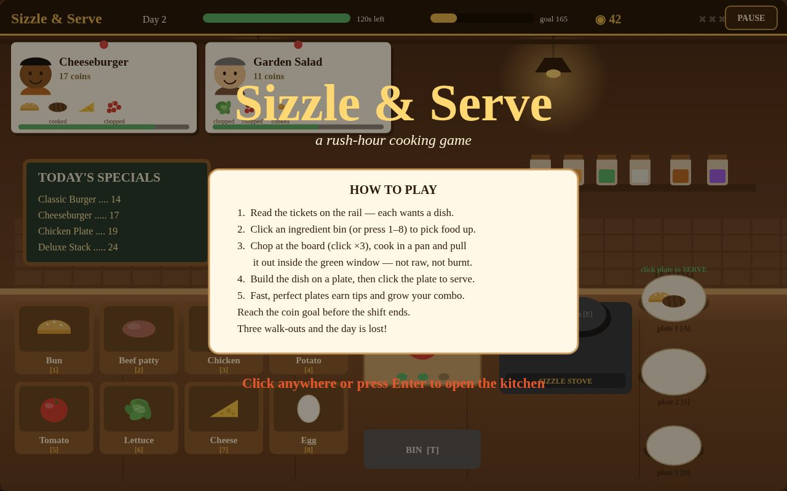
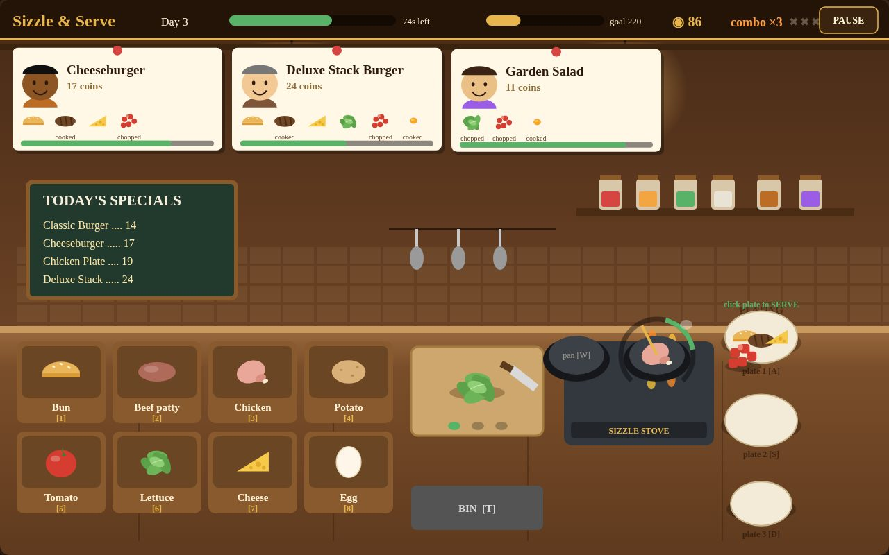
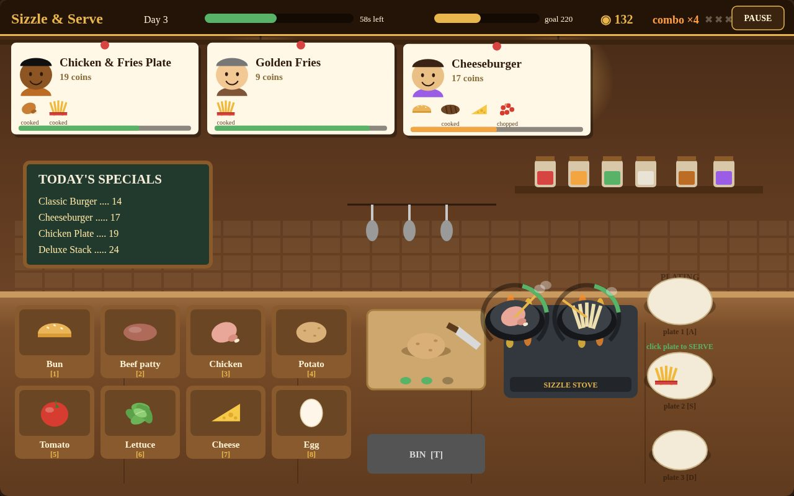
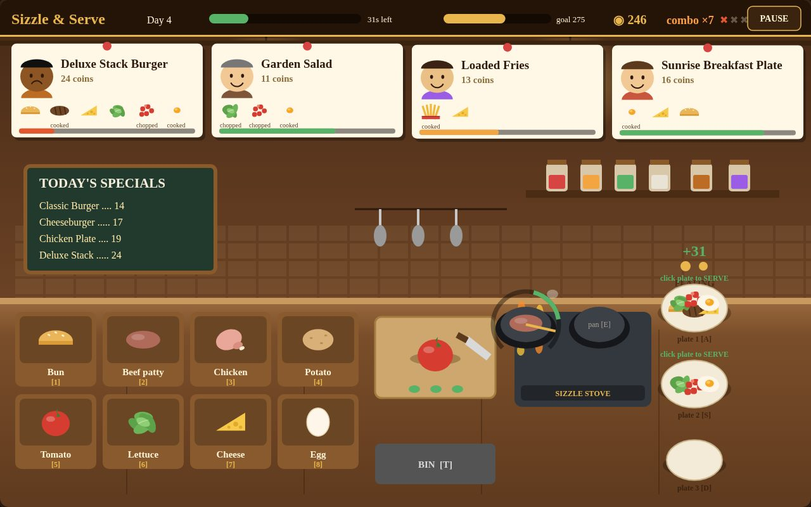

# Sizzle & Serve — a rush-hour cooking game

[](https://make.fun/bounty/best-cooking-game-20261125-0137)
[](https://make.fun/bounty/best-cooking-game-20261125-0137)
[](https://make.fun/bounty/best-cooking-game-20261125-0137)



**Sizzle & Serve** is a complete cooking game that runs in a desktop browser from static files — no build step, no network requests, every sound synthesized live and every dish drawn in code. Customers pin tickets to the rail; you chop, cook, plate and serve against their patience, chase the day's coin goal before the shift clock runs out, and try not to let three of them walk out.

## At a glance

| | |
| --- | --- |
| Game | Sizzle & Serve |
| Genre | Cooking / time-management arcade |
| Controls | Mouse (click stations) and keyboard (1–8 bins, Q board, W/E pans, A/S/D plates, T bin, P pause) |
| Recipes | 8 dishes, unlocked across days (Classic Burger → Deluxe Stack Burger) |
| Ingredients | 8 (bun, beef patty, chicken, potato, tomato, lettuce, cheese, egg) |
| Stations | Ingredient counter, chopping board, twin-burner stove with a doneness window, 3-plate plating shelf |
| Structure | 120-second shifts, rising coin goals, escalating rush, combo tips, 3 walk-out strikes |
| Tech | Canvas 2D + WebAudio, plain ES modules, zero dependencies, plays fully offline |

## Screenshots

The mid-assembly moment: a cheeseburger half built on plate 1, chopped tomato in hand, lettuce on the board, chicken in the pan, three tickets on the rail.



Both burners working: chicken in the perfect window, fries coming up, a potato mid-chop, and a finished plate of fries ready to serve.



The full rush on day 4: four tickets (one nearly out of patience), two finished plates waiting to serve, a combo of ×7 and the coin popup still in the air.



## How to play

1. Read the tickets on the rail — each shows a dish, its parts and a patience bar.
2. Click an ingredient bin (or press 1–8) to pick food up.
3. Chop at the board (three clicks), cook in a pan and pull the food out inside the green doneness window — too early is undercooked, too late is burnt.
4. Build the dish on a plate, then click the plate to serve it.
5. Fast plates earn tips; perfectly cooked parts earn a bonus; serves in a row grow your combo.
6. Reach the coin goal before the shift ends to clear the day. Three walk-outs end it early.

## Run it

Serve `game/` with any static file server and open `index.html` in a desktop browser — it plays offline from its own files. The hand-in program at the repository root copies the game and screenshots to the output directory and writes the dossier:

```sh
mkdir -p out && MAKEFUN_OUTPUT_DIR=out node main.ts
```

## Layout

- `main.ts` — the hand-in program (Node 22, standard library only)
- `vendor/makefun-game.ts` — the make.fun dossier library, as shipped in the kit
- `game/index.html` — the page; `game/src/` holds the game, one job per file: `recipes.js` (pantry and menu), `orders.js` (tickets and serving), `stations.js` (board, pans, plates), `render-kitchen.js` (the kitchen and the food art), `render-hud.js` (tickets, clock, screens), `audio.js` (synthesized sounds), `input.js`, `state.js`, `shots.js` (the deterministic screenshot scenes behind `?shot=`)
- `screenshots/` — real renders of the game, staged with `?shot=cover|assembly|cooking|rush`

## License

MIT — see `LICENSE`.

Built for the [Make the best cooking game](https://make.fun/bounty/best-cooking-game-20261125-0137) bounty on [make.fun](https://make.fun).
